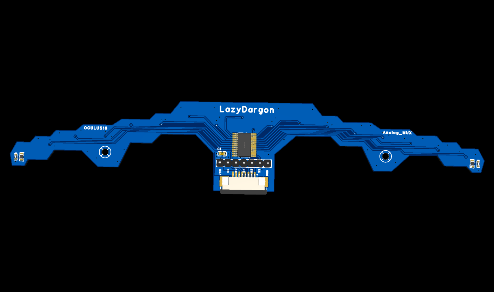

# LazyDragon Oculus-16 — Analog IR Sensor Array



The **LazyDragon Oculus-16 analog IR sensor array** is a 16-channel reflective
infrared line-sensor board. Its 16 QRE1113GR sensors are multiplexed through a
74HCT4067 16:1 analog mux down to a **single analog output**, so a host MCU can
read all 16 channels while leaving almost every pin free for motors, encoders,
and control.


This page covers the hardware at a glance. For the code walkthrough see
[`MANUAL.md`](MANUAL.md); for troubleshooting see [`DEBUG.md`](DEBUG.md).

---

## Overview

Each of the 16 sensing positions is a QRE1113GR reflective IR opto-sensor: an
infrared emitter paired with a phototransistor. The emitter bounces IR off the
surface below; the phototransistor current rises when the surface is
reflective and falls when it is dark. The 16 phototransistor outputs feed the
inputs (`Y0`..`Y15`) of a **74HCT4067PW** 16:1 analog multiplexer, whose common
output (`Z`, routed to net `C0`) is the board's only analog signal. Four select
lines (`S0`..`S3`) choose which sensor is presented on `C0`, so the board
presents 16 channels through a 7-wire interface. All thresholding and
calibration happen in firmware.

The board is laid out as two wings of eight sensors flanking a central mux, with
mounting holes designed for a front-mounted line-follower. Wiring is symmetric;
if the array is mounted mirrored, channel order is simply reversed in firmware.

---

## Highlights

- **16 channels on one analog pin.** A 74HCT4067 16:1 mux collapses sixteen
  sensor readouts into a single ADC input plus four digital selects.
- **Sensor-per-channel gain matching easy in firmware.** Every channel has its
  own 47 kΩ load, so each can be normalized independently.
- **Emitter-pair sharing.** Emitters are wired in series pairs with one 150 Ω
  current-limiting resistor per pair — lower part count, matched brightness.
- **Compact, low-cost interface.** Seven wires (GND, +5V, S0..S3, C0) carry the
  whole array; an 8-pin 1.0 mm FPC is provided for a tidy ribbon cable.
- **Board-level status LEDs.** Two onboard yellow LEDs for power/activity
  indication.

---

## Specifications

| Spec | Value |
|------|-------|
| Sensor | 16x QRE1113GR reflective IR opto-sensor |
| Channels | 16 (`Y0`..`Y15`), multiplexed to one analog output |
| Multiplexer | 74HCT4067PW-Q100J, single-pole 16-throw (16:1) analog |
| Mux on-resistance | ~80 Ω typical at VCC = 4.5 V |
| Select lines | 4 (`S0`..`S3`), TTL level (74HCT) |
| Common output | `Z` (net `C0`), analog 0..VCC |
| Board size | 154.12 mm x 29.23 mm |
| Mounting holes | 2, spaced 91.000 mm apart |
| Emitter drive | emitters in series pairs, one 150 Ω per pair (8 total) |
| Phototransistor load | 16x 47 kΩ |
| Decoupling | 1x 1 µF |
| Indicators | 2x yellow LED, 150 Ω each |
| Interface | 7-pin 2.54 mm header `H2` + 8-pin 1.0 mm FPC `CN1` |
| Emitter peak wavelength | 940 nm |
| Sensor operating temperature | -40 to +85 °C |
| Supply | +5 V |

Mechanical drawings, assembly images, the schematic, the BOM, and the
manufacturing package are in `assets/`, `datasheets/`, and `fabrication/`.

---

## Repository structure

```
oculus16/
├── README.md
├── MANUAL.md
├── DEBUG.md
├── CHANGELOG.md
├── LICENSE            # hardware — CC BY-NC-SA 4.0
├── LICENSE-CODE       # firmware — PolyForm Noncommercial 1.0.0
├── COMMERCIAL-LICENSE.md
├── assets/            # images, schematic, BOM
├── datasheets/        # vendor datasheets
├── fabrication/       # gerbers, drill, pick-and-place
└── code/              # firmware / source
```

---

## Getting started

### Hardware

1. Power the board from **+5 V** and **GND** (via `H2` or the `CN1` FPC).
2. Connect the four select lines `S0`..`S3` and the common analog output `C0`
   to your MCU (see **Pinout / wiring**).
3. Mount the array a small, fixed distance above the surface; keep the sensing
   gap consistent across all 16 sensors.

### Software

1. Open `code/oculus_16.ino` in the Arduino IDE (ATmega328P / Arduino Nano
   target) and flash it.
2. On boot, sweep the array across the line for four seconds so it can
   calibrate; it then streams 16 calibrated channels plus position and status
   over Serial at 115200 baud.

The sketch scans all 16 mux channels continuously from the ADC-complete
interrupt — the main loop never calls `analogRead()`.

---

## Usage / configuration

The reader cycles the mux and reads one channel at a time. The select lines map
directly to the mux channel:

| S3 | S2 | S1 | S0 | Channel |
|----|----|----|----|---------|
| 0 | 0 | 0 | 0 | `Y0` |
| 0 | 0 | 0 | 1 | `Y1` |
| ... | ... | ... | ... | ... |
| 1 | 1 | 1 | 1 | `Y15` |

Key configuration constants at the top of `code/oculus_16.ino`:

| Constant | Default | Meaning |
|----------|---------|---------|
| `NUM_SENSORS` | `16` | Channels scanned, mux 0..15. |
| `IS_BLACK_LINE` | `true` | `true` for a dark line on a light floor. |
| `ON_THRESHOLD` | `500` | Calibrated value (0..1000) above which a channel is "on line". |
| `EDGE_SENSOR_COUNT` | `2` | A cluster confined to this many outer sensors is reported as an edge. |
| `POSITION_SCALE` | `1000` | Integer position scale factor. |
| `SENSOR_WEIGHT[]` | `-15..+15` | Symmetric weights used by the centroid. Flip if mirrored. |
| `MUX_SHIFT` / `MUX_MASK` | `0` / `0x0F` | Mux select `S0`..`S3` on `A0`..`A3` (PORTC 0..3). |
| `MUX_COMMON` | `4` | ADC channel of the mux common output (`A4`). |

See [`MANUAL.md`](MANUAL.md) for the full function reference.

---

## Pinout / wiring

**`H2` — 7-pin 2.54 mm header**

| Pin | Function |
|-----|----------|
| 1 | GND |
| 2 | S3 |
| 3 | S2 |
| 4 | S1 |
| 5 | S0 |
| 6 | C0 (mux common analog output) |
| 7 | +5 V |

**`CN1` — 8-pin 1.0 mm FPC (`KH-CL1.0-H2.5-8PIN`)**

| Pin | Function |
|-----|----------|
| 1 | S3 |
| 2 | S2 |
| 3 | S1 |
| 4 | S0 |
| 5 | C0 |
| 6 | GND |
| 7 | +5 V |
| 8 | +5 V |

**Host MCU wiring (Arduino Nano / ATmega328P, as used by `code/oculus_16.ino`)**

| Signal | Nano pin | ATmega |
|--------|----------|--------|
| `S0` | `A0` | PC0 |
| `S1` | `A1` | PC1 |
| `S2` | `A2` | PC2 |
| `S3` | `A3` | PC3 |
| `C0` | `A4` | ADC4 |
| GND | GND | — |
| +5 V | +5V | — |

The mux enable `E#` is tied to GND on the board, so no host pin is needed.
`A6`/`A7` are analog-only and cannot drive the select lines.

---

## Documentation

- [`MANUAL.md`](MANUAL.md) — usage and code/function reference.
- [`DEBUG.md`](DEBUG.md) — expected behavior and troubleshooting.
- [`CHANGELOG.md`](CHANGELOG.md) — version history.
- [`COMMERCIAL-LICENSE.md`](COMMERCIAL-LICENSE.md) — commercial licensing and royalties.
- Schematic and BOM: [`assets/`](assets/)
- Manufacturing files (gerbers, drill): [`fabrication/`](fabrication/)

---

## License

This project is **source-available, not open source**.

- **Hardware** (PCB, schematic, assets) — [`LICENSE`](LICENSE) ·
  [CC BY-NC-SA 4.0](https://creativecommons.org/licenses/by-nc-sa/4.0/): free
  for personal and non-commercial use with attribution; commercial use requires
  a separate license.
- **Firmware** (`code/`) — [`LICENSE-CODE`](LICENSE-CODE) ·
  [PolyForm Noncommercial 1.0.0](https://polyformproject.org/licenses/noncommercial/1.0.0):
  free for non-commercial use.

**Commercial use requires a paid license** (royalty + attribution). See
[`COMMERCIAL-LICENSE.md`](COMMERCIAL-LICENSE.md) or contact
**contact@lazydragon.club**.

### No warranty

The design and firmware are provided **"as is", without warranty of any kind**.
LazyDragon Pvt Ltd is **not liable** for any damages arising from their use. You
use this project at your own risk; verify all safety and certification
requirements before any product use.

> These licenses are non-commercial, so this is **not** an OSI open-source or
> OSHWA-certified open-hardware release.

**Background.** LazyDragon is a startup building open hardware. This board is
one of its earlier builds — designed from scratch in high school — now released
to the community alongside newer designs. These earlier releases are published
under source-available, non-commercial licenses.
